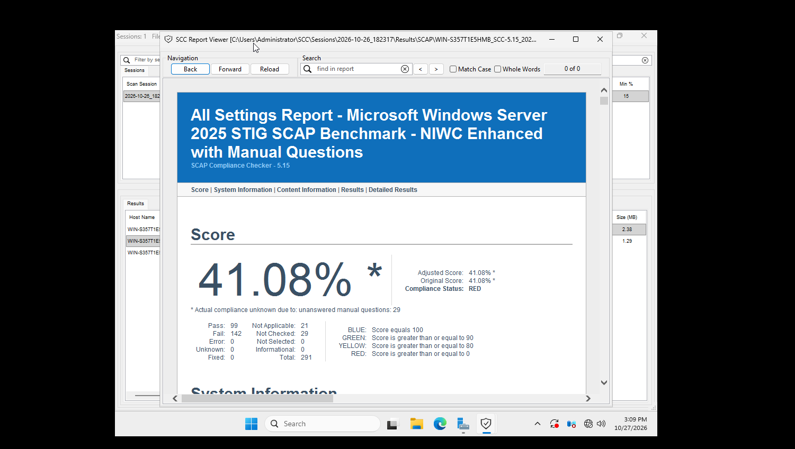
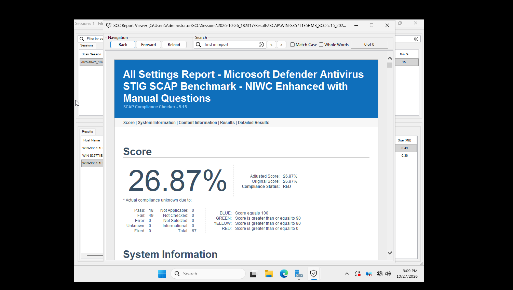
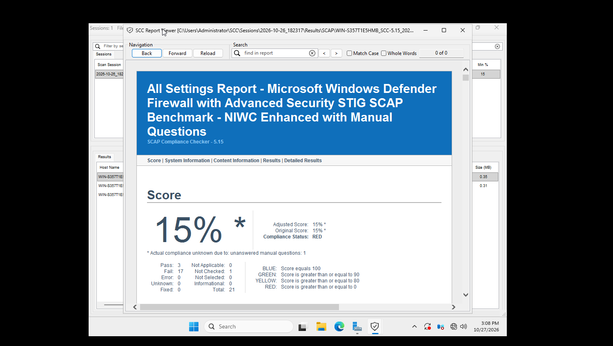
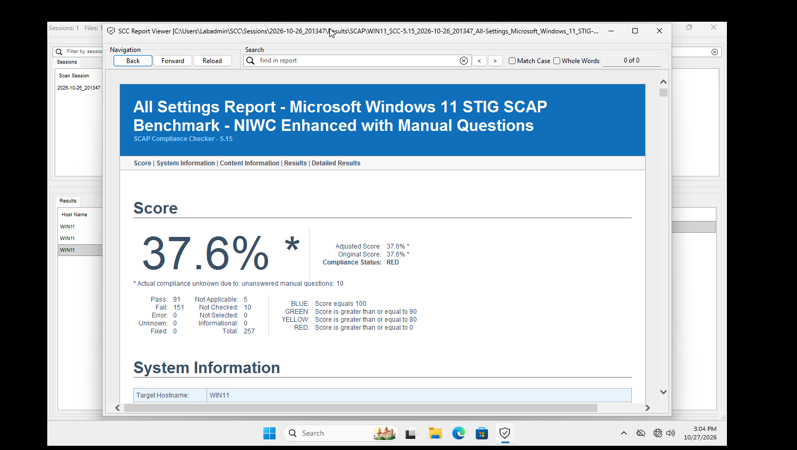
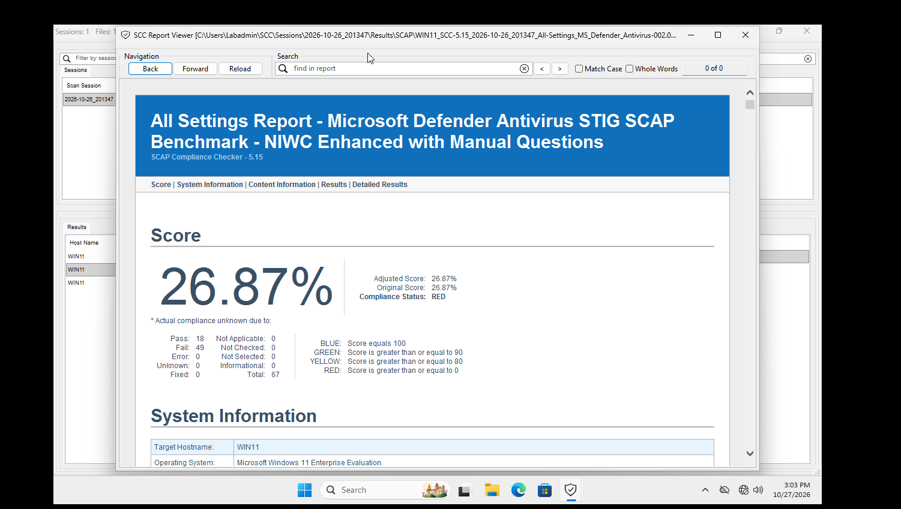
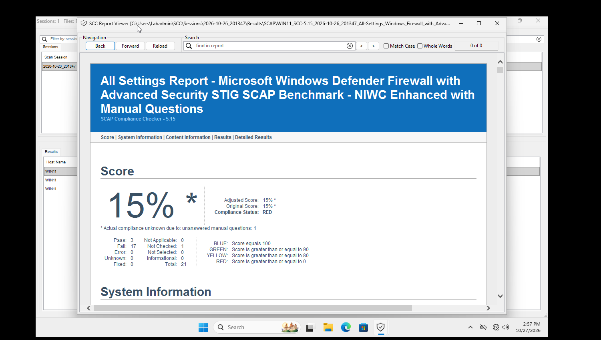

# Baseline Scan

## Getting and using SCC
SCC (SCAP Compliance Checker) is a free DoD tool made by NIWC Atlantic. I used it to scan my Windows machines against the DISA STIGs where it then gave me a compliance score.

Getting the tool was difficult and took me longer than expected. I first checked NIWC's GitHub, but the releases page was empty. Then I tried DISA's website, and it sent me to a DoD login page that needed a CAC (military ID card). I didn't try to sign in. I was sure that the tool was publicly available as NIWC's SCAP page says it is. I saw that 5.15 is the latest version, but it only had the checksum file, not the installer. I ended up getting the installer from DISA's public download server, which didn't need a login:

https://dl.dod.cyber.mil/wp-content/uploads/stigs/zip/scc-5.15_Windows_bundle.zip

NIWC's SCAP page says SCC has been publicly available since version 5.4:
https://www.niwcatlantic.navy.mil/Technology/SCAP/

## Checking the installer

Since I got the installer from a link I built myself instead of one listed on an official page, I checked it before running it on my domain controller.

- **Digital signature:** The installer is signed by NIWC Atlantic (CS.NIWC-ATLANTIC.001). Windows said the signature was OK.
- **SHA-256 hash:** I ran `Get-FileHash` and compared it to the checksum file from NIWC's site. They matched.

The installer came from DISA's server and the checksum came from NIWC's site, so a tampered file would have to fool two different official sources. This lines up with NIST 800-53 SI-7 (Software Integrity).

When installing, I left the SCC Service unchecked. It's only needed for remote or scheduled scans, and I didn't want to add a service to the DC that I wasn't using (CM-7, Least Functionality).

## What I scanned against

I used the STIG content that comes bundled with SCC 5.15. On the server I scanned the Windows Server 2025, Defender, and Firewall STIGs. On WIN11 I used the Windows 11 STIG instead of the server one. 

SCC used the MAC-1_Classified profile, which is the default and the strictest one. I'm keeping the same STIGs and profile for the rescan so the before and after numbers are actually comparable.

| Benchmark | Version | Scanned on |
|---|---|---|
| Windows Server 2025 STIG | V1R1 | Server-DC01 |
| Windows 11 STIG | V2R10 | WIN11 |
| Microsoft Defender Antivirus STIG | V2R9 | Both |
| Windows Defender Firewall STIG | V2R3 | Both |

## Results

### Server-DC01 (Oct 26, 2026)

| Benchmark | Score | Pass | Fail | Not checked | Total |
|---|---|---|---|---|---|
| Windows Server 2025 | 41.08% | 99 | 142 | 29 | 291 |
| Defender Antivirus | 26.87% | 18 | 49 | 0 | 67 |
| Windows Firewall | 15% | 3 | 17 | 1 | 21 |

Average: 27.65%

### WIN11 (Oct 26, 2026)

| Benchmark | Score | Pass | Fail | Not checked | Total |
|---|---|---|---|---|---|
| Windows 11 | 37.6% | 91 | 151 | 10 | 257 |
| Defender Antivirus | 26.87% | 18 | 49 | 0 | 67 |
| Windows Firewall | 15% | 3 | 17 | 1 | 21 |

Average: 26.49%

## What I noticed

Every benchmark came back RED on both machines, which is probably normal considering a fresh Windows install. The server scored a little higher on its OS STIG (41.08%) than WIN11 did on the Windows 11 STIG (37.6%).

The Defender (26.87%) and Firewall (15%) scores were exactly the same on both machines. That makes sense because neither one had been configured yet, so both were failing the same rules on Microsoft's default settings. The Firewall STIG was the worst at 15%.

The WIN11 scan took over an hour because it was still on the HDD at the time.

## Screenshots

**Server scores**

- 
- 
- 

**WIN11 scores**

- 
- 
- 
