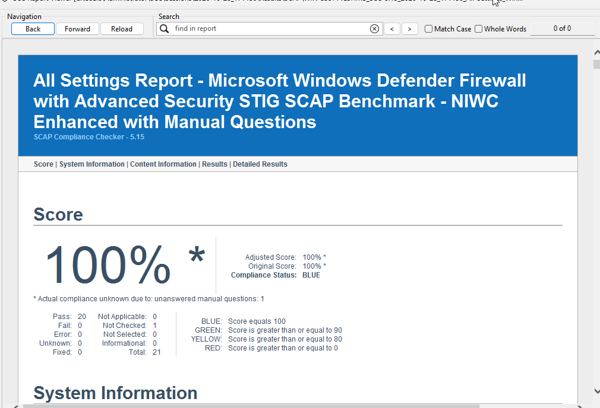
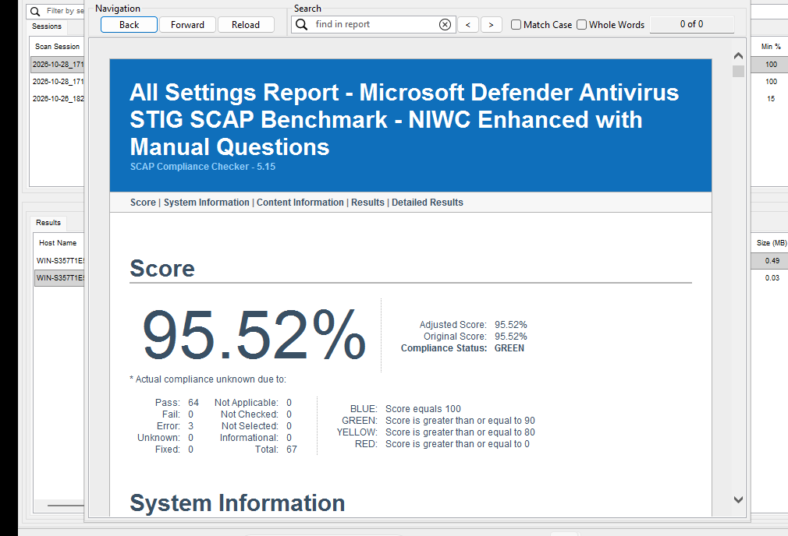
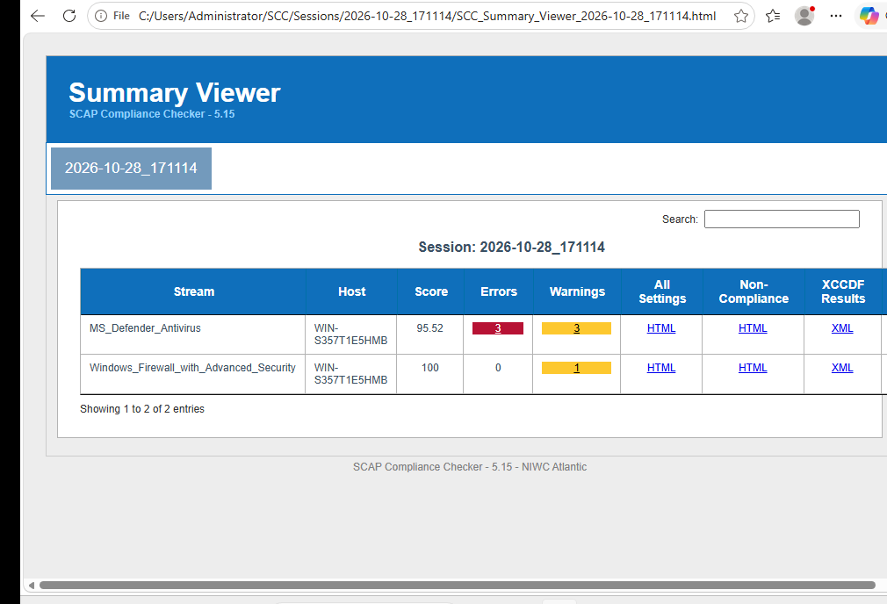
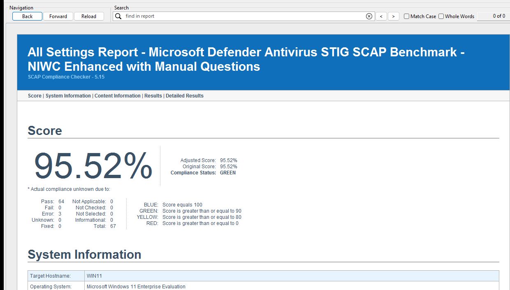
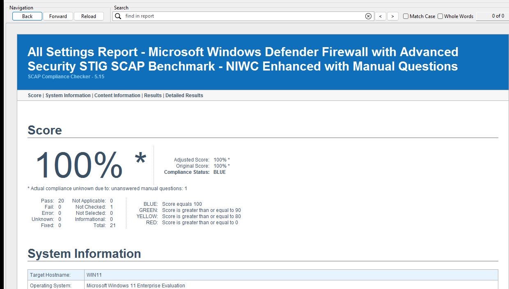
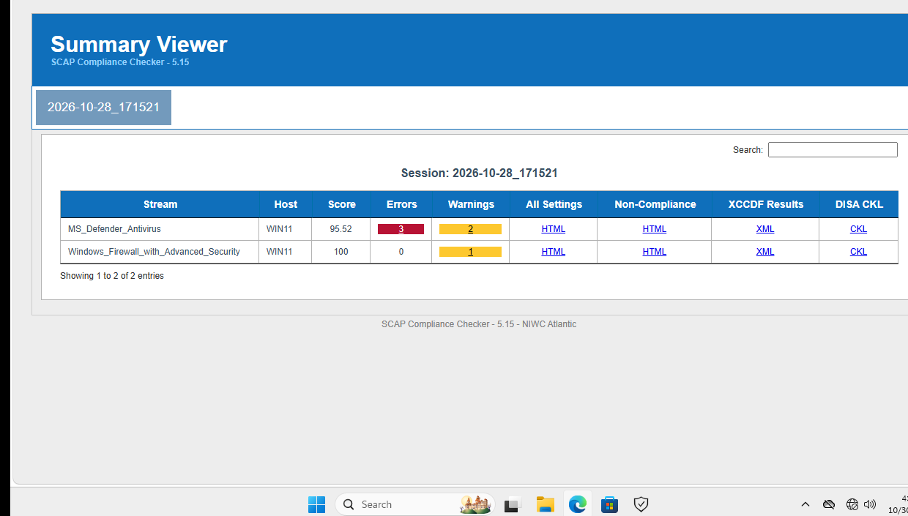

# 04 – Rescan Results

## Stage 1: Defender and Firewall GPOs (Oct 28, 2026)

Before rescanning, I linked DISA’s Defender and Firewall GPOs to the Domain Controllers and Workstations OUs. The difference was night and day in that they took Defender from 26.87% to 95.52% and Firewall from 15% to 100% on both machines. 

Both sessions had 3 errors for the Defender scan. Turns out it was because SCC was denied access to what Defender excludes. Get-MpPreference returned “Administrators are not allowed to view exclusions". After going into the GPO settings I found that Defender STIG GPO enables “Control whether or not exclusions are visible to Local Admins,” so this confirmed that the hardening itself blocked the scanner. I also checked that nothing had told Defender to skip any files or folders, so these 3 rules weren’t actually a security problem. The scanner just wasn’t allowed to look. 

## What Was Scanned
I scanned both with the following:
- MS_Defender_Antivirus
- Windows_Firewall_With_Advanced_Security

| System | STIG | Before | After | Change |
|---|---|---|---|---|
| Server-DC01 | Defender Antivirus | 26.87% | 95.52% | +68.65 |
| Server-DC01 | Windows Firewall | 15% | 100% | +85 |
| WIN11 | Defender Antivirus | 26.87% | 95.52% | +68.65 |
| WIN11 | Windows Firewall | 15% | 100% | +85 |

## Stage 2: Windows 11 GPOs

My goal for stage 2 was apply DISA’s Windows 11 GPOs to WIN11, see what and how much it corrects, then fix any needed manual changes. My baseline scan from Oct 26 had WIN11 at 37.6% on the Microsoft_Windows_11_STIG benchmark. I then linked DISA’s Windows 11 Computer GPO to the Workstations OU and the User GPO to the Users OU and rescanned. The score changed to 92.98%. A considerable jump, but 17 rules still failed and needed manual changes to further strengthen the system.

| System | STIG | Before | After |
|---|---|---|---|
| WIN11 | Windows 11 | 37.6% | 92.98% |

## Screenshots

Server

Win11

